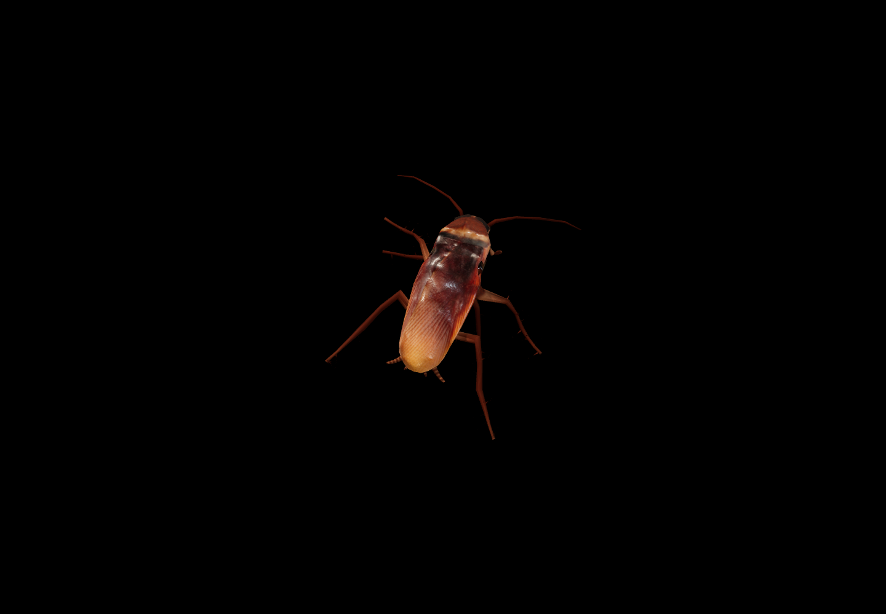

# Nocturne

An interactive 3D cockroach wallpaper on a completely black background. Fast walking, restrained body movement, calmer antennae, and click-triggered flight — with no text or controls over the scene.



## Try it

Download this repository using **Code → Download ZIP**, extract it, and open **cockroach.html** in a modern browser with WebGL enabled. The HTML includes the renderer, model, textures, and animation. No server or internet connection is needed after downloading.

| Input | Action |
| --- | --- |
| Move the cursor | Attract attention; a quick movement nearby can trigger an escape |
| Left click | Unfold the wings, fly, and land |
| Right drag or Alt-drag | Orbit the camera |
| Scroll | Zoom |
| Space | Pause or resume |
| F | Toggle fullscreen |
| Escape | Reset the camera |

The model's walk cycle is used for the legs. Antenna and torso motion are damped separately. Wing deployment and flight are procedural approximations; this is an artistic wallpaper, not a biologically validated simulation.

## Use it as a macOS wallpaper

Requires macOS 13 or later, Python 3, and Xcode Command Line Tools (`xcode-select --install`). From the extracted project folder:

```sh
python3 scripts/install-macos.py
```

This compiles a local app, installs it at `~/Applications/Nocturne.app`, and enables login startup using `~/Library/LaunchAgents/com.lersent.nocturne.plist`. It uses a separate app identity from Deskworlds. No administrator access is required.

Use the menu-bar icon to pause, take flight, or quit. Pointer movement reaches the wallpaper while desktop icons remain usable. Clicking exposed desktop space while Finder is active triggers flight. Browser camera and keyboard controls apply to the browser preview; the desktop host remains click-through.

The host adapts frame rate to power and visibility conditions. It uses WebKit behavior that may vary across macOS versions. This is a locally compiled, ad-hoc-signed app, not a notarized distribution.

To stop the app and disable login startup:

```sh
launchctl bootout "gui/$(id -u)/com.lersent.nocturne"
rm "$HOME/Library/LaunchAgents/com.lersent.nocturne.plist"
```

You may then move `~/Applications/Nocturne.app` to the Trash. Reinstallation preserves one previous app as `Nocturne.previous.app`.

## Build the single HTML file

Requires Node.js 22.12 or later.

```sh
npm ci
npm run build
```

Edit `src/main.js` for scene behavior. `assets/cockroach.glb` contains the model and walking animation. The build bundles these into `cockroach.html`, including the third-party license notices. The checked-in HTML is ready to use without Node.js.

## Acknowledgments and license

This project is inspired by [Deskworlds](https://github.com/chaseleantj/deskworlds) by **Chase Lean**. Its macOS wallpaper host, desktop-window integration, power management, and menu-bar infrastructure are adapted from that project. Deskworlds is MIT-licensed; its original copyright and full permission notice are preserved in [licenses/deskworlds-MIT.txt](licenses/deskworlds-MIT.txt). Nocturne is an independent derivative, not an official Deskworlds release.

The code is available under the [MIT License](LICENSE). Third-party artwork and model assets retain their respective licenses. See [Third-party notices](THIRD_PARTY_NOTICES.md) for attribution, source links, license terms, and modification details.
